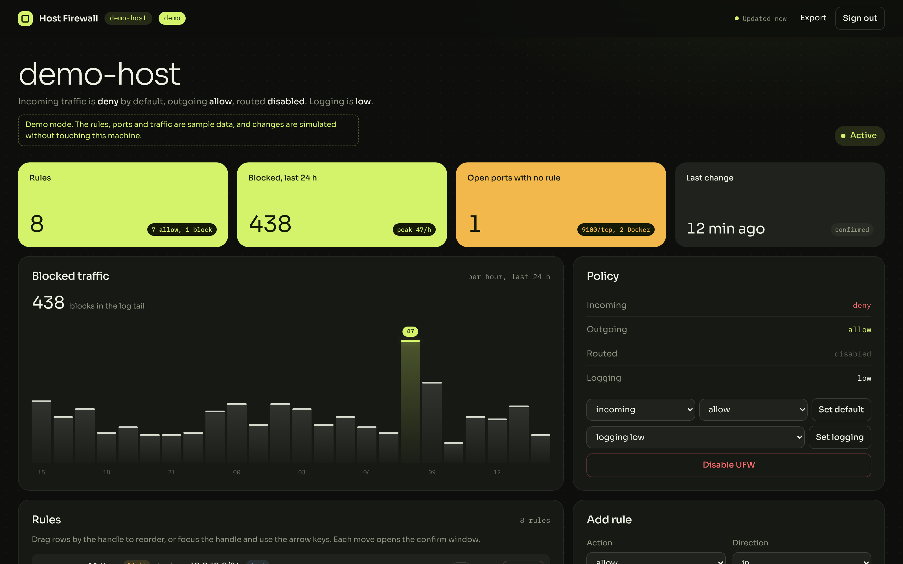
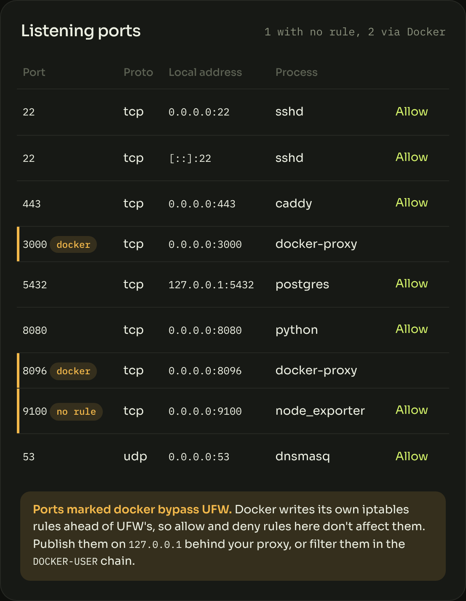
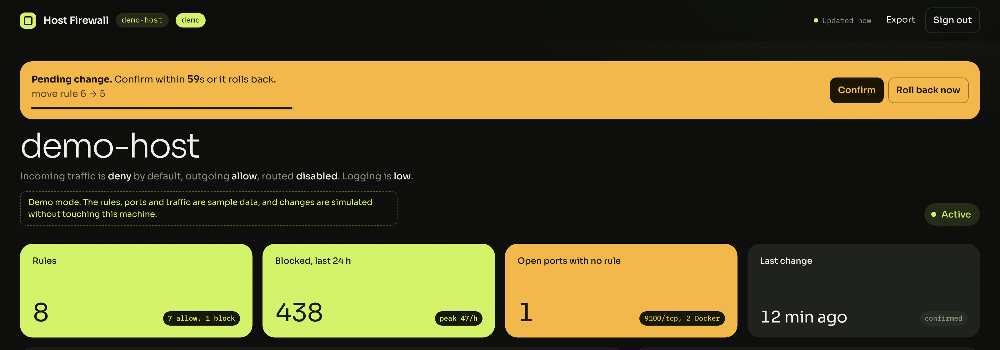
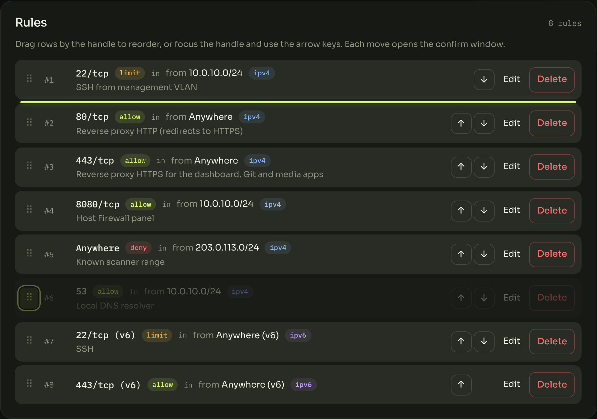
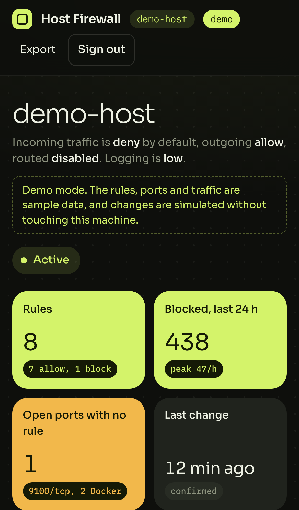

# Host Firewall

A small web panel for **UFW on a single Ubuntu host**, built so that a bad
change can't lock you out: every edit opens a confirm window, and if you don't
confirm in time (or lose access), the previous rules come back on their own.

[](https://github.com/reonsmith/host-firewall/actions/workflows/ci.yml)
[](https://github.com/reonsmith/host-firewall/releases)
[](https://github.com/reonsmith/host-firewall/pkgs/container/host-firewall)
[](LICENSE)



## What it does

- **Rules with labels.** Add, edit, delete and insert allow / deny / reject /
  limit rules with comments, IPv4 and IPv6 badges, and app-profile suggestions.
- **Reorder by dragging**, with arrow keys, or with up and down buttons. Works on touch screens.
- **Confirm or roll back.** Each change snapshots `/etc/ufw`, applies, then waits
  60 seconds (configurable) for you to confirm. No confirm, no change.
- **See what's hitting the host.** Blocks per hour for the last 24 hours, recent
  log hits with one-click **Block IP**, and a guess at which rule matched.
- **Find gaps.** Listening ports from `ss`, with ports that have no allow rule
  highlighted, and **ports published by Docker flagged** (they bypass UFW; see below).
- **Policy controls.** Enable or disable UFW, set default policies and the logging level.
- **Backups and history.** Export `/etc/ufw` as a `.tar.gz`, restore earlier
  snapshots, and see every confirmed or rolled-back change.

It is a **host** firewall panel, not a network edge firewall, and it has a single
shared password. Keep it on your LAN or behind a reverse proxy with TLS.

## Try the demo

Demo mode serves sample rules, ports and traffic. Changes are simulated, and the
container gets no host access or extra capabilities.

```bash
docker run --rm -p 127.0.0.1:8080:8080 -e HOST_FIREWALL_DEMO=1 ghcr.io/reonsmith/host-firewall:latest
```

Open <http://localhost:8080> and sign in with `host-firewall-demo`.

## Install

You need Ubuntu (or another distro with UFW) and Docker with Compose v2.

```bash
git clone https://github.com/reonsmith/host-firewall.git
cd host-firewall
cp .env.example .env
nano .env        # set the password and secret key; check the bind address
docker compose pull
docker compose up -d
```

`docker compose up -d --build` builds from source instead of pulling the image.

The container runs with `network_mode: host` and `NET_ADMIN` / `NET_RAW` so it
can manage the host's UFW. It mounts `/etc/ufw`, `/etc/default/ufw` and,
read-only, `/var/log`. Treat it as having full control of the host firewall.

### Behind a reverse proxy

Bind the panel to localhost and let your proxy handle TLS:

```dotenv
# .env
HOST_FIREWALL_BIND=127.0.0.1
HOST_FIREWALL_PORT=8080
```

```caddyfile
firewall.example.com {
    reverse_proxy 127.0.0.1:8080
}
```

The session cookie is marked `Secure` automatically when the proxy reports
HTTPS (`X-Forwarded-Proto`).

### Docker and UFW

Docker writes its own iptables rules, which are evaluated **before** UFW's. A
port published with `-p 8096:8096` is reachable from anywhere even if UFW's
default is deny. Host Firewall marks these ports in **Listening ports** so they
don't look protected when they aren't.



To close the gap, either publish container ports on `127.0.0.1` and reach them
through your reverse proxy, or filter them in the `DOCKER-USER` iptables chain.

### Logs and the traffic chart

The chart and **Traffic hits** read UFW lines from `/var/log/ufw.log`,
`kern.log` and `syslog`. Logging has to be on (`low` is enough), and the chart
needs ISO-8601 timestamps, which is rsyslog's default on current Ubuntu. Hosts
without rsyslog can mirror the journal with
`journalctl -k -g UFW -o short-iso >> /var/log/ufw.log`.

## Configuration

Set these in `.env` next to `docker-compose.yml`.

| Variable | Default | Notes |
|---|---|---|
| `HOST_FIREWALL_PASSWORD` | (required) | At least 12 characters |
| `HOST_FIREWALL_SECRET_KEY` | (required) | At least 32 characters; signs the session cookie |
| `HOST_FIREWALL_BIND` | `0.0.0.0` | Use `127.0.0.1` behind a proxy, or a LAN address. `.env.example` uses `127.0.0.1` |
| `HOST_FIREWALL_PORT` | `8080` | |
| `HOST_FIREWALL_LABEL` | `host` | Host name shown in the header |
| `HOST_FIREWALL_CONFIRM_SECONDS` | `60` | How long you have to confirm a change |
| `HOST_FIREWALL_COOKIE_SECURE` | `auto` | `auto`, `true` or `false` |
| `HOST_FIREWALL_LOG_PATHS` | `/var/log/ufw.log:/var/log/kern.log:/var/log/syslog` | Colon-separated |
| `HOST_FIREWALL_LOG_LIMIT` | `80` | Rows in **Traffic hits** |
| `HOST_FIREWALL_DEMO` | off | `1` for demo mode |
| `HOST_FIREWALL_TAG` | `latest` | Image tag used by `docker-compose.yml` |

## How rollback works

1. You make a change. The panel snapshots `/etc/ufw` into its data directory.
2. The change is applied and a banner starts counting down.
3. **Confirm** keeps it. **Roll back now**, or letting the timer run out,
   restores the snapshot and reloads UFW.

The countdown runs in the server, not your browser, so it still rolls back if
the change cut off your own connection. If you do get locked out, use the
console or SSH.



Failed sign-ins are limited per IP: five failures within five minutes lock that
IP out for five minutes.

## More screenshots

| Rules, while dragging | Phone |
|---|---|
|  |  |

[Full dashboard](docs/screenshots/dashboard-full.png) · [Sign-in](docs/screenshots/login.png)

## API

JSON endpoints under `/api/*` use the same session cookie (`POST /api/login`).

- `GET /api/health` (no auth), `/api/status`, `/api/rules`, `/api/logs`, `/api/ports`,
  `/api/apps`, `/api/history`, `/api/snapshots`, `/api/pending`, `/api/export`
- `POST /api/rules`, `PUT /api/rules/{n}`, `DELETE /api/rules/{n}`, `POST /api/rules/{n}/move`
- `POST /api/ufw/enable`, `/api/ufw/disable`, `/api/ufw/default`, `/api/ufw/logging`
- `POST /api/snapshots/restore`, `/api/pending/confirm`, `/api/pending/rollback`

Every mutating endpoint opens the confirm window, just like the UI.

## Development

```bash
python -m venv .venv && source .venv/bin/activate
pip install -e ".[dev]"
pytest -v
HOST_FIREWALL_DEMO=1 HOST_FIREWALL_DATA_DIR=./data-demo python -m backend
```

See [CONTRIBUTING.md](CONTRIBUTING.md) for the ground rules, and
[CHANGELOG.md](CHANGELOG.md) for what changed in each release.

## Security

Report vulnerabilities privately; see [SECURITY.md](SECURITY.md).

## License

MIT. See [LICENSE](LICENSE).
